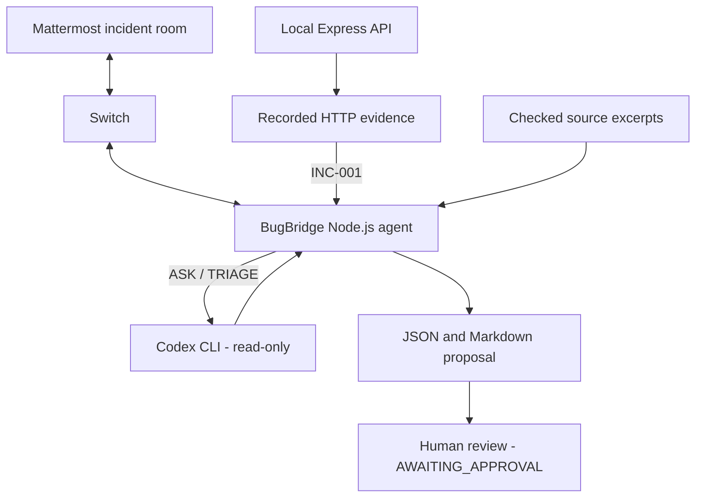

# BugBridge

**Investigate a reproducible API bug from team chat, with evidence and a fix proposal ready for review.**

BugBridge connects a Mattermost incident room to a Node.js agent through Switch. The agent uses Codex to inspect a known issue, compare the recorded HTTP behavior with the expected result, and return a source-backed proposal to the same conversation. The proposal is saved as JSON and Markdown for human review.

This is a local **investigation-and-review demo**, not an automatic bug-fixing system. The included incident is deliberately left unfixed.

## Demo

[Watch the BugBridge hackathon demo](https://youtu.be/TluzvBd5sqE?si=Ni4mOHRu04yWJzHy)

The demo covers the HTTP reproduction, Mattermost commands, Codex-assisted triage, saved incident report, and the disabled patch-execution boundary. See the [demo runbook](docs/demo-workflow.md) to reproduce the workflow locally.

## The problem

A message saying “the API is broken” rarely gives a developer enough information to act. The request, observed response, relevant code, and proposed next step may be spread across chat and terminal output.

BugBridge gives that discussion a concrete record: **what happened, what should have happened, where the likely cause is, and what a reviewer should check before changing code.**

## How it works

1. A developer sends a command in an existing Mattermost incident room.
2. Switch routes the message to the subscribed BugBridge agent.
3. `PING` checks the message path. `ASK` sends a bounded project question to Codex. `TRIAGE` analyzes verified evidence and allowlisted source excerpts for `INC-001`.
4. BugBridge validates the assessment, writes a structured report, and replies to the same room.
5. The proposed change remains `AWAITING_APPROVAL`; no code is patched automatically.



The REST API and chat agent run as separate processes. A healthy API does **not** mean the Switch/Mattermost connection is working. TRIAGE reads previously checked evidence; it does not perform new HTTP requests when the chat command arrives.

For implementation details, see [architecture.md](docs/architecture.md), [switch-client.mjs](switch-bridge/switch-client.mjs), and [message-handler.mjs](switch-bridge/message-handler.mjs).

## Supported chat commands

Send these one at a time in the configured incident room (the local demo uses `bugbridge-incidents`):

| Command | Result |
| --- | --- |
| `PING BUGBRIDGE` | Confirms the agent can receive a message and reply through Switch. Codex is not invoked. |
| `ASK BUGBRIDGE: What is the expected status for an empty task creation request?` | Asks Codex a project question and returns the answer in the same room. |
| `TRIAGE BUGBRIDGE INC-001` | Checks stored evidence and source references, requests a Codex assessment, and saves a reviewable proposal. |

Commands are case-insensitive. ASK requires the colon. ASK and TRIAGE share one analysis slot; PING can still respond while analysis is running. Codex calls have a 120-second timeout. TRIAGE currently supports **only `INC-001`**.

## Example incident: INC-001

An intentionally preserved branch in [tasks.controller.js](src/controllers/tasks.controller.js) throws a generic error before task input validation. This changes what should be a client-side validation failure into an internal server error.

| Request | Expected | Observed |
| --- | --- | --- |
| `POST /api/tasks` with `{}` | `400 VALIDATION_ERROR` | `500 INTERNAL_ERROR` |
| `POST /api/tasks` without a body | `400 VALIDATION_ERROR` | `500 INTERNAL_ERROR` |
| Valid task creation | `201` | `201` |

The proposed correction is small: remove the intentional throw and the now-unused `isObject` import, then run the relevant regression and API checks. **The correction has not been applied.**

Evidence and examples:

- [Recorded HTTP evidence](reports/phase9-bug-evidence.md)
- [Reviewed incident report](reports/incidents/INC-001-triage.md)
- [Sanitized report example](docs/examples/incident-report.sample.json)

A saved report's analyst field is provenance metadata, not proof that a new live Codex call or Mattermost delivery happened during a particular demonstration. Verify the report timestamp and the corresponding live session separately.

## Technology

| Component | Role |
| --- | --- |
| Node.js 22+ | API, agent, scripts, and built-in tests; recorded local checks used Node.js 24 |
| Express 5 | Local task API with in-memory storage |
| `ws` | Switch agent WebSocket client |
| Switch | Routes team messages and agent replies |
| Mattermost | Existing incident discussion room |
| Codex CLI | Read-only project questions and source-backed incident assessment |
| Windows PowerShell | Documented local startup and Windows-specific security checks |

The API and agent have separate `package.json` files and lockfiles.

## Getting started

### 1. Install dependencies

Requirements: Windows PowerShell, Node.js 22+ and npm. Clone this repository, open a terminal in its root, then run:

```powershell
node --version
npm.cmd --version

npm.cmd ci
if ($LASTEXITCODE -ne 0) { throw 'API installation failed.' }

npm.cmd --prefix switch-bridge ci
if ($LASTEXITCODE -ne 0) { throw 'Agent installation failed.' }
```

The REST API and automated tests can run without Switch, Mattermost, or Codex.

### 2. Start the demo API

Use a dedicated PowerShell terminal in the project root:

```powershell
$env:HOST = '127.0.0.1'
$env:PORT = '3100'
npm.cmd start
```

Leave this terminal open. The application defaults to port 3000, but this demo uses **3100** to avoid the existing Switch Gateway's configured port. If 3100 is already in use, check whether the API is running before starting another process. Do not stop an unrelated service. Tasks are kept in memory and reset when the API restarts.

### 3. Check the HTTP behavior

In a second PowerShell terminal:

```powershell
curl.exe -i http://127.0.0.1:3100/health
curl.exe -i -X POST http://127.0.0.1:3100/api/tasks -H 'Content-Type: application/json' --data '{}'
curl.exe -i -X POST http://127.0.0.1:3100/api/tasks
```

Expected **observations**: health `200`; both empty task requests `500`. The `500` responses reproduce the known defect. The correct behavior would be `400`. A valid `201` control and storage/health checks are covered by the recorded evidence and automated reproduction tests.

### 4. Set up live Mattermost integration (optional)

Live chat testing has additional prerequisites **not included in a fresh clone**:

- A working local Switch deployment, its Mattermost integration, and a mapped incident room.
- An agent registered with that Switch deployment and the credentials issued for **that** agent and room.
- An authenticated Codex CLI compatible with the runner in [codex-runner.mjs](switch-bridge/codex-runner.mjs). If necessary, configure `CODEX_BIN` to the installed executable.

Provision Switch, the Mattermost room, and agent registration using the deployment owner's **version-specific setup instructions**. BugBridge does not install Switch, register agents, issue keys, or provide the original operator's credentials. The current agent expects Switch core at `127.0.0.1:8000`.

The bridge reads three environment variables:

| Variable | Where it comes from |
| --- | --- |
| `SWITCH_AGENT_ID` | Registered Switch agent ID |
| `SWITCH_AGENT_KEY` | Authentication key issued to that agent |
| `SWITCH_ROOM_ID` | Configured Switch room ID mapped to Mattermost |

Once your own agent and room are configured, use a **separate PowerShell terminal** in the repository root. Do this only if another BugBridge connection is **not** running:

```powershell
$env:SWITCH_AGENT_ID = Read-Host 'Switch agent ID'
$env:SWITCH_ROOM_ID = Read-Host 'Switch room ID'
$secureKey = Read-Host 'Switch agent key' -AsSecureString
$env:SWITCH_AGENT_KEY = [System.Net.NetworkCredential]::new('', $secureKey).Password
Remove-Variable secureKey

npm.cmd --prefix switch-bridge start
```

These values are set for the current terminal session, not committed to Git. Never paste keys into issues, recordings, screenshots, source files, or `.env` files tracked by Git. A second bridge connection may evict the existing one.

Wait for connection/subscription logs, then send the commands from [Supported chat commands](#supported-chat-commands) in Mattermost. A connected socket alone does not prove message delivery; confirm a real reply in the same room. The [demo runbook](docs/demo-workflow.md) includes existing-service checks, report archival, and troubleshooting precautions.

### 5. Inspect the triage result

After a **successful live TRIAGE** response, review:

```powershell
Get-Content -LiteralPath '.\reports\incidents\INC-001-triage.md'
Get-Content -LiteralPath '.\reports\incidents\INC-001-triage.json'
node scripts/check-approval-readiness.mjs
```

Check the report generation time, analyst provenance, evidence references, `AWAITING_APPROVAL`, `approvalRequired: true`, and `applied: false`. A report from an earlier run may still exist if the latest request fails. Preserve the existing report pair using the [runbook](docs/demo-workflow.md) before generating a fresh one.

Do **not** run `npm.cmd run reproduce:bug` just to test the chat command: it refreshes canonical evidence and may invalidate the current proposal's evidence digest.

## Tests and verification

Run commands from the repository root:

| Command | Coverage |
| --- | --- |
| `npm.cmd test` | Normal API behavior |
| `npm.cmd run test:investigation` | HTTP evidence handling, redaction, and cleanup |
| `npm.cmd run test:phase7` | Bridge, triage, approval, and isolated workflow tests |
| `npm.cmd run test:submission` | Submission scanner test fixtures |
| `npm.cmd run smoke` | API entrypoint, CRUD, and recovery behavior |
| `npm.cmd run security:submission` | Heuristic scan of public-file candidates; not a complete secrets audit |
| `npm.cmd run verify:local` | Combined verification, including Windows-native security checks; see the runbook's execution-policy preflight |
| `npm.cmd run test:bug` | **Expected to fail**: asserts the intended 400 behavior while the known bug still returns 500 |

`verify:local` runs local HTTP and isolated fixtures, including **mocked Switch peers and Codex subprocesses**. It does not establish a live Mattermost session or invoke the real model. Missing Windows-native ACL checks can cause a `FAILED_OR_BLOCKED` result; do not treat that as a passing run.

Recorded verification results (different runs, **not** one current combined result):

| Run | Passed | Unexpected failures | Skipped | Notes |
| --- | ---: | ---: | ---: | --- |
| Phase 14 local verification, 6 Nov 2026 | 300 | 0 | 1 | Earlier successful normal test run |
| Later environment-restricted verification | 278 | 22 | 5 | Blocked by host restrictions; not a full pass |
| Publication security tests | 11 | 0 | 0 | Security-specific tests only |

The intentionally failing HTTP-400 regression is separate from the normal-suite totals. For test scope, known limitations, and dated evidence, see [end-to-end verification](docs/end-to-end-verification.md).

## Security and current limitations

- **No automatic fixes.** Patch execution is disabled, and the intentional API bug remains in place.
- **No live approval claim.** Human enrollment is incomplete and deployed sender authentication is unverified. Approval-related automated tests use synthetic identities and keys.
- **Local API only.** The Express demo has no authentication, rate limiting, or persistent storage. Keep it bound to `127.0.0.1` and use synthetic data.
- **Read-only is not private by default.** Codex may process inspected content through its configured service. ASK has a broader inspection surface than TRIAGE; use a clean demo workspace.
- **Limited incident scope.** Live TRIAGE currently supports `INC-001`, not arbitrary issues.
- **Credentials are not distributed.** Each operator must provision an authorized Switch agent and room. Local key material, private approval data, and unreviewed captures must stay out of the repository.

For the underlying trust boundaries and checks, read [security-review.md](docs/security-review.md).

## Repository layout

```text
src/                    Express demo API and the intentional bug
tests/                  API, investigation, setup, and submission tests
switch-bridge/          Switch client, agent runtime, Codex runner, and triage
scripts/                Local verification and reproduction utilities
fixtures/               Synthetic incident fixture
reports/                Reviewed evidence and incident reports
docs/                   Architecture, runbook, verification, and examples
```

Ignored local material, including `reports/private/`, keys, and raw captures, is **not** part of the public repository.

## Hackathon

Built for **WeMakeDevs Flip the Switch**, **Best Business Workflow** track. BugBridge demonstrates a documented handoff from a team-chat incident to reproducible evidence, source-supported investigation, and a proposed change awaiting human review.
