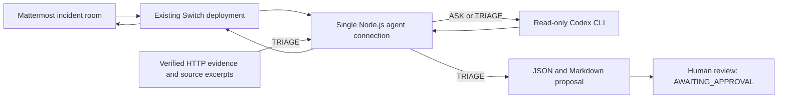

# BugBridge

BugBridge investigates a reproducible API incident from Mattermost through Switch and returns a Codex-assisted proposal for human review.

## The problem

A bug report is difficult to act on when the request, observed response and relevant code are scattered across a chat thread. A useful handoff needs reproducible evidence, an explanation supported by the source, and a proposed change that someone can review.

BugBridge keeps that handoff in the incident conversation. The included case is deliberately small: an Express API returns the wrong HTTP status for an empty task-creation request.

## What BugBridge does

- Reproduces the HTTP error using synthetic requests, with a valid control request and storage/health checks.
- Receives explicit PING, ASK and TRIAGE commands through an existing Switch-connected Mattermost room.
- Uses Codex in a read-only process to answer project questions or assess the checked evidence for `INC-001`.
- Saves a structured JSON proposal and readable Markdown report, then sends a summary to the same configured room.
- Records the proposed fix as `AWAITING_APPROVAL`. Automatic patch execution is disabled.

TRIAGE currently supports one registered incident, `INC-001`. This is a working investigation and review demo with a fixed incident registry; it is not a general-purpose incident-management service.

## Why Switch matters

Switch provides the connection between the existing Mattermost incident room and BugBridge's Node.js agent. The agent subscribes to that room over an authenticated WebSocket. Replies go through the Switch HTTP message endpoint with the same room binding, and the existing collaboration bridge delivers them to Mattermost.

For ASK and TRIAGE, the path is **Mattermost → Switch → Node.js agent → Codex → Node.js agent → Switch → the same Mattermost room**. PING checks the message path without invoking Codex. The REST API is a separate process; a successful `/health` request does not prove that chat delivery works.

The transport, room filtering, duplicate suppression, heartbeat and reconnect code are in [switch-client.mjs](switch-bridge/switch-client.mjs) and [message-handler.mjs](switch-bridge/message-handler.mjs).

## Demo

**YouTube video: pending — the actual recording link will be added here.**

The [three-minute demo script](docs/demo-script.md) shows the intended presentation. The operator previously observed successful real PING, ASK/Codex and TRIAGE exchanges in earlier sessions. A fresh response from the latest TRIAGE session has not been verified in this review; current live acceptance remains **PENDING**.

No screenshot or recording is supplied as proof of a new live run. The pending video link does not block review of the repository.

## Architecture



The loopback Express API supplies the reproducible incident. TRIAGE consumes previously collected evidence; its chat command does not run new HTTP probes. See [architecture and trust boundaries](docs/architecture.md) for the detailed contracts.

## Supported commands

Send these in the existing configured incident room, commonly `bugbridge-incidents`:

| Command | Behavior |
| --- | --- |
| `PING BUGBRIDGE` | Replies with the online message, without calling Codex. |
| `ASK BUGBRIDGE: What status should an empty task creation return?` | Sends a bounded project question to Codex and replies in the same room. The colon is required. |
| `TRIAGE BUGBRIDGE INC-001` | Validates stored evidence and source references, requests a schema-constrained Codex assessment, saves the proposal and replies with its summary. |

Commands are case-insensitive and may use the optional `@bug-triager` prefix. Unsupported incident IDs are rejected. ASK and TRIAGE share one analysis slot; a second request receives a busy reply while PING remains available. The Codex process has a 120-second timeout.

## Real example: INC-001

The controller marker is `BUG-001`; its incident record is `INC-001`.

| Request | Expected | Observed in the recorded evidence |
| --- | --- | --- |
| `POST /api/tasks` with `{}` | `400 VALIDATION_ERROR` | `500 INTERNAL_ERROR` |
| `POST /api/tasks` with no body | `400 VALIDATION_ERROR` | `500 INTERNAL_ERROR` |
| Valid task creation | `201` | `201` |

In [tasks.controller.js](src/controllers/tasks.controller.js), an intentional guard throws a generic `Error` before normal input validation. The error middleware maps that exception to a sanitized HTTP 500. The existing validator would reject those inputs with HTTP 400.

The proposed change removes the empty-input throw and its unused `isObject` import, keeping normal validation and generic-error sanitization. It has **not been applied**. The proposal remains **AWAITING_APPROVAL** with human approval required.

Start with the [sanitized incident sample](docs/examples/incident-report.sample.json) or the [reviewed triage report](reports/incidents/INC-001-triage.md). The sample is documentation, not a new execution record. The current proposal records `rootCause.analyst: CODEX_CLI`; that field alone does not prove a fresh model invocation or Mattermost delivery. Older local-review artifacts use `LOCAL_SOURCE_REVIEW`.

## Tech stack

| Component | Use |
| --- | --- |
| Node.js 22+ | API and bridge runtime; built-in test runner, HTTP, fetch and cryptography. Recorded checks used Node.js 24.20.0. |
| Express 5 | Local task API with in-memory storage. |
| `ws` | Agent WebSocket client and isolated protocol-test peers. |
| Switch and Mattermost | Existing collaboration deployment and incident room. |
| Codex CLI | Existing authenticated installation, invoked through `execFile` in a read-only sandbox. |
| Windows PowerShell | Documented operator workflow and native approval-storage ACL checks. |

Both npm packages have lockfiles. The API's only direct dependency is Express; the bridge's is `ws`.

## Local setup

### Prerequisites

The API and automated fixtures can run independently of the collaboration deployment. For a live demo, you also need:

- An existing working Switch/Mattermost deployment, its Mattermost collaboration bridge, incident-room mapping and registered `bug-triager` agent. These are managed outside this repository.
- Access to the existing agent credentials and room configuration through your authorized local setup.
- An authenticated Codex CLI compatible with the arguments in [codex-runner.mjs](switch-bridge/codex-runner.mjs). Set `CODEX_BIN` to your existing executable if needed; otherwise the runner uses the Codex application installation under `LOCALAPPDATA`.

A fresh clone does not create Docker services, configure Mattermost, register an agent, provision credentials or authenticate Codex. Obtain the deployment's version-specific setup from its owner. This runtime expects Switch core at `http://127.0.0.1:8000`; the existing Mattermost address comes from your deployment.

### Install dependencies

Open Windows PowerShell in the BugBridge root. Install before starting the bridge; leave an already running demo undisturbed.

```powershell
node --version
npm.cmd --version
npm.cmd ci
if ($LASTEXITCODE -ne 0) { throw 'API dependency installation failed.' }
npm.cmd --prefix switch-bridge ci
if ($LASTEXITCODE -ne 0) { throw 'Bridge dependency installation failed.' }
```

### Start the API

If the demo API is already running, use it. Otherwise, in its own terminal:

```powershell
$env:HOST = '127.0.0.1'
$env:PORT = '3100'
npm.cmd start
```

The application default is port 3000. This demo explicitly uses 3100 to avoid the existing Gateway's port. If 3100 is occupied, inspect the existing process; do not stop another service to make room. Tasks are held in memory and disappear when this API process restarts.

### Use the existing bridge connection

The existing configured bridge terminal must provide these variables without exposing their values:

| Variable | Purpose |
| --- | --- |
| `SWITCH_AGENT_ID` | Existing agent registration. |
| `SWITCH_AGENT_KEY` | Existing agent authentication key. |
| `SWITCH_ROOM_ID` | Existing room subscription and reply destination. |

Keep an existing bridge running. A second connection can evict it; do not run `check-connection.mjs` alongside the runtime. **Only after confirming that no bridge instance is running**, start it once in the already configured terminal:

```powershell
if (-not $env:SWITCH_AGENT_ID -or -not $env:SWITCH_AGENT_KEY -or -not $env:SWITCH_ROOM_ID) {
    throw 'Use the existing configured terminal; do not print or replace credentials.'
}
npm.cmd --prefix switch-bridge start
```

Wait for `switch_connected` with `subscribed=true`. That confirms reported subscription acceptance, not end-to-end delivery. The [local runbook](docs/demo-workflow.md) covers existing-service checks and operator preflight.

## Reproduce the demo

With the API running on 3100, use a separate PowerShell terminal:

```powershell
curl.exe -i http://127.0.0.1:3100/health
curl.exe -i -X POST http://127.0.0.1:3100/api/tasks -H 'Content-Type: application/json' --data '{}'
curl.exe -i -X POST http://127.0.0.1:3100/api/tasks
```

Expect health 200 and HTTP 500 for both empty requests. The [stored HTTP evidence](reports/phase9-bug-evidence.md) also records a valid 201 control, unchanged storage after invalid requests and health recovery.

In the existing Mattermost incident room, send each command separately and wait for its reply:

```text
PING BUGBRIDGE
ASK BUGBRIDGE: What is the expected status for an empty task creation request?
TRIAGE BUGBRIDGE INC-001
```

Observe the actual same-room reply. If PING fails, stop the sequence and use the [communication investigation](docs/ping-communication-investigation.md); do not open another agent connection. If analysis fails, report the failure rather than substituting an old or mocked response.

Successful TRIAGE writes these proposal files:

```powershell
Get-Content -LiteralPath '.\reports\incidents\INC-001-triage.md'
Get-Content -LiteralPath '.\reports\incidents\INC-001-triage.json'
```

Check the proposal generation time, evidence timestamp, provenance, `AWAITING_APPROVAL`, `approvalRequired: true` and `applied: false`. An old file can survive a failed request. Before a new live TRIAGE, use the runbook's archive step to preserve the existing proposal pair.

The separate `npm.cmd run reproduce:bug` command collects fresh HTTP evidence and overwrites the canonical `reports/phase9-bug-evidence.json` and `.md`. Refreshing it changes the evidence digest and can invalidate an existing proposal. It is not required for the chat demonstration using the checked-in evidence; review and preserve the matching artifacts before refreshing them.

## Testing

Run from the project root:

| Command | What it checks |
| --- | --- |
| `npm.cmd test` | Normal task API behavior through local HTTP. |
| `npm.cmd run test:investigation` | Reproduction, evidence handling, redaction and temporary-server cleanup. |
| `npm.cmd run test:phase7` | Bridge, triage, approval and isolated local workflow tests. |
| `npm.cmd run test:submission` | Submission scanner fixtures and actual Git ignore rules in disposable metadata. |
| `npm.cmd run smoke` | Real API entrypoint, health, CRUD and recovery with the preserved 500. |
| `npm.cmd run test:bug` | Correct HTTP-400 regression; intentionally exits with failure while INC-001 is preserved. |
| `npm.cmd run verify:local` | Combined local verification, native ACL gates, syntax, smoke and separate regression checks. |
| `npm.cmd run security:submission` | Heuristic current-file security scan; it does not clear Git history or excluded files. |

The combined verifier saves new evidence under a separate `reports/local-demo/` run directory. It does not invoke real Codex or the deployed Switch. Follow the runbook's host-policy preflight; missing native ACL checks produce `FAILED_OR_BLOCKED`, not a pass. Do not change execution policy merely to hide unavailable checks.

Recorded results are from different runs:

| Recorded run | Passed | Failed | Skipped | Meaning |
| --- | ---: | ---: | ---: | --- |
| Historical Phase 14, 2026-11-06 07:47 UTC | 300 | 0 | 1 | Historical successful normal-suite verification. |
| Later communication investigation | 278 | 22 | 5 | Broad verification remained blocked; native ACL checks were unavailable and a sampled enrollment failure confirmed PowerShell script restrictions. |
| Phase 16A publication security tests | 11 | 0 | 0 | Security-only checks; not a full-suite rerun. |

The intentional HTTP-400 regression is separate from these normal-suite totals: its recorded failure confirms the preserved 500 response. [Dated verification records](docs/submission-checklist.md#phase-14-verification-results) and the [E2E verification notes](docs/end-to-end-verification.md) explain the boundaries.

Automated workflow tests use real local HTTP, file validation and cryptography, with **mocked Switch peers and Codex subprocesses**. They do not prove live Mattermost delivery or a real model response. Historical operator-observed live exchanges are described in the Demo section; fresh live acceptance remains pending.

## Security boundaries and limitations

- **Automatic patch execution is disabled.** The execution entry point refuses even after a simulated approval. `INC-001` remains intentionally unfixed.
- **Human enrollment is incomplete and live sender authentication is unverified.** Approval checks require trusted identity and authorization; display names and room membership cannot grant approval. Enrollment or activation is not part of this demo.
- **The API is a local demo, not a production service.** It has no authentication, rate limiting or durable storage. Keep it on loopback with synthetic tasks.
- **Read-only execution does not guarantee confidentiality.** ASK can inspect the project more broadly than TRIAGE. Use synthetic questions and a clean demo workspace; model input may leave the machine through the existing Codex service.
- **Publication needs its own review.** Keep credentials, signing keys, DPAPI exports, private approval storage, account IDs, raw incident data and recordings out of Git. Existing ignore rules must remain intact; a pattern scan cannot prove their contents or history are safe.

See the [security review](docs/security-review.md) and [publication checklist](docs/submission-checklist.md) for the detailed findings and release checks.

## Project structure

```text
src/                    Express task API and intentional BUG-001 branch
tests/                  API, evidence, enrollment and submission tests
switch-bridge/          Agent runtime, Switch transport, Codex runner and triage
  test/                 Bridge protocol, command and approval tests
scripts/                Verification, reproduction and operator helpers
fixtures/               Fixed synthetic bug description
reports/                Reviewed HTTP evidence, proposals and dated verification
  private/              Ignored private reports and local audit artifacts
docs/                   Architecture, demo runbook and historical reviews
  examples/             Sanitized documentation sample
```

The dependency trees are installed locally and excluded from Git. Private report and approval storage must stay excluded; publish only individually reviewed artifacts.

## Hackathon

Built for **WeMakeDevs Flip the Switch**, track **Best Business Workflow**. The demonstrated workflow is a reproducible incident moving from a Mattermost request, through Switch and Codex analysis, to an evidence-backed proposal awaiting human review.
