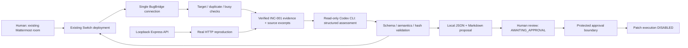

# BugBridge

**Evidence-based bug triage in Mattermost, powered by Switch and a read-only Codex agent.**

BugBridge turns a reproducible API incident into a structured fix proposal that a human can review in the team's existing conversation. Built for **WeMakeDevs Flip the Switch — Best Business Workflow**, it demonstrates investigation and a protected handoff, not automatic code repair.

The local demo supports **PING, ASK and evidence-based TRIAGE** through the existing Switch/Mattermost connection. INC-001 (controller marker BUG-001) deliberately returns HTTP 500 for empty task creation instead of 400. The proposal remains **AWAITING_APPROVAL**. Approval safeguards and a signed-local alternative are implemented and tested, but real human enrollment is incomplete and deployed sender authentication is unverified. **Automatic patch execution is disabled, including after simulated approval.**

Deployment is not required. Use the existing local Docker/Mattermost/Switch stack, Node.js and authenticated Codex CLI. Do not start a second bridge connection or recreate Docker services for this demo. No live approval or automatic fixing is claimed.

Start with the [three-minute demo script](docs/demo-script.md), [local runbook](docs/demo-workflow.md), [architecture](docs/architecture.md), [dated verification results](docs/submission-checklist.md#phase-14-verification-results), and [publication checklist](docs/submission-checklist.md). Historical Phase 14 verification on 2026-11-06 at 07:47 UTC recorded **300 passed, 0 failed, 1 skipped**. The later [communication investigation](docs/ping-communication-investigation.md#actual-local-verification) recorded **278 passed, 22 failed, 5 skipped** across its normal suites; native ACL checks were unavailable and a sampled enrollment failure confirmed PowerShell script restrictions. That later run was not a full PASS. Phase 16A reran only publication security tests: **11 passed, 0 failed, 0 skipped**. The intentional HTTP-400 regression remains a separate expected failure, not a passing test.

The operator previously observed real Mattermost PING replies, real ASK/Codex replies and successful TRIAGE in earlier sessions. Those historical successes are preserved. No fresh response from the latest TRIAGE session was verified in this publication review; current live acceptance remains **PENDING**. The inspected proposal records `rootCause.analyst: CODEX_CLI`; its on-disk provenance does not prove fresh Mattermost delivery. Automated protocol/model fixtures do not establish live E2E success.

## Problem and business workflow

Teams often lose the request, expected response and source context while a bug moves between chat and an engineer. BugBridge keeps the evidence, diagnosis, proposed change and human-review status together. A support or QA engineer can reproduce an incident, request triage from the incident room, and hand a concrete proposal to a maintainer. No business-loss, time-saving or production-impact metric is claimed.

## Features

- Real HTTP reproduction of both empty-body variants, a valid control, storage checks and health recovery.
- `PING BUGBRIDGE`, `ASK BUGBRIDGE: ...` and `TRIAGE BUGBRIDGE INC-001` through the existing agent connection.
- Evidence/source hash validation, schema-constrained Codex assessment and local JSON/Markdown proposals.
- Same-room replies, duplicate suppression, responsive heartbeats, bounded execution and reconnect handling.
- Tested human-approval safeguards and signed-local verification; real enrollment/authentication are incomplete and patch execution stays disabled.

## Why Switch is central

Switch connects the existing Mattermost room to the registered `bug-triager` agent, delivers room events and accepts the response through the same authenticated client. BugBridge uses that transport instead of adding a separate Mattermost bot or webhook integration. The workflow is **Mattermost → Switch → Node bridge → Codex → Node bridge → Switch → Mattermost**. Running API tests alone does not demonstrate Switch integration; a fresh room exchange does.

## Tech stack and prerequisites

| Component | Role |
| --- | --- |
| Windows 11 / PowerShell 5.1 | Verified operator environment; use `npm.cmd` |
| Node.js >=22 / npm | API, bridge, built-in test runner, fetch and crypto; verified runtime v24.20.0 |
| Express 5 | Separate loopback REST API with isolated in-memory storage |
| `ws` | Existing single-room Switch WebSocket client |
| Existing local Docker + Mattermost + Switch | Collaboration services, managed separately from BugBridge |
| Authenticated Codex CLI | Read-only investigation using the existing login |
| Git | Public-repository review and ignore-rule verification |

There are two npm packages and two committed lockfiles. No new paid service, frontend, database, Docker configuration or deployment is required by BugBridge. AI inference may use the existing Codex service; local demo hosting does not mean offline inference. Use synthetic data only.

## Architecture



The bridge and API are separate Node packages and processes. Starting the API does not connect to Switch or invoke Codex. API tests use real local HTTP requests and no AI services.

```text
src/
  app.js                       Express factory; separate storage per instance
  server.js                    Local HTTP entrypoint
  routes/tasks.routes.js       Task routes and ID validation
  controllers/tasks.controller.js
  services/tasks.service.js    In-memory storage and UUID generation
  validation/tasks.validation.js
  middleware/error-handler.js
tests/
  tasks.test.js                Normal HTTP API tests
  helpers/http.js
  regression/empty-body.test.js  Intentionally failing BUG-001 regression
fixtures/bug-reports.json      Machine-readable report and reproductions
scripts/smoke-test.js          Starts the actual API entrypoint on a free port
docs/                         Phase verification evidence
switch-bridge/                Existing Phase 7 integration; unchanged in Phase 8
```

## Installation and running

Requires Node.js 22 or newer and npm. Express 5 is the API's only direct dependency.

From the BugBridge root:

```powershell
node --version
npm.cmd --version
npm.cmd ci
if ($LASTEXITCODE -ne 0) { throw 'API install failed.' }
npm.cmd --prefix switch-bridge ci
if ($LASTEXITCODE -ne 0) { throw 'Bridge install failed.' }
```

**Demo API: port 3100.** Switch Gateway may already use 3000. Audit bind checks found 3000 occupied and 3100 available at that moment; recheck before starting. This probe releases its socket, so the actual API bind remains the final authority. Do not stop another process or change the Gateway to make room.

```powershell
node --input-type=module -e "import { createServer } from 'node:net'; const s=createServer(); s.once('error',()=>{console.error('Port 3100 unavailable; stop and review.');process.exitCode=1;}); s.listen({host:'127.0.0.1',port:3100,exclusive:true},()=>s.close(()=>console.log('Port 3100 bind check passed and released.')));"
if ($LASTEXITCODE -ne 0) { throw 'STOP: demo port unavailable.' }
$env:HOST = '127.0.0.1'
$env:PORT = '3100'
npm.cmd start
```

In another terminal, `curl.exe -i http://127.0.0.1:3100/health` should return 200. The application default remains 3000 for compatibility; the demo explicitly overrides it. `PORT=0` selects an ephemeral port for isolated automated verification. No environment file is required or loaded by the API. Keep the unauthenticated demo on loopback.

The existing bridge retains its own dependencies, commands and environment configuration. Use its existing configured terminal. Keep a running bridge running; start `npm.cmd --prefix switch-bridge start` only when no bridge instance exists. Never print the credential values. See the demo runbook for preflight and startup gates.

### Docker-based Switch and existing agent setup

BugBridge does not bundle or provision Switch/Mattermost. It expects the operator's existing local deployment and registered agent/room. [The runbook](docs/demo-workflow.md#existing-docker-services) provides exact commands to inspect existing services and start only a verified stopped long-running container. It does not run setup/init services, recreate Compose projects, register another agent/room or start a replacement socket. The inspected Switch checkout has distinct `deploy/local/docker-compose.yml` and `deploy/local/standalone-docker-compose.yml` variants; they are not interchangeable and source files do not prove the running deployment.

For a new machine, obtain the Switch version-specific deployment/bootstrap procedure and existing registration from its authorized owner before the live demo. This repository makes standalone API/tests reproducible; it does not invent credentials or promise a one-command fresh Switch installation. Existing bridge variables are `SWITCH_AGENT_ID`, `SWITCH_AGENT_KEY` and `SWITCH_ROOM_ID`; check presence without displaying values. Start the existing registration only if no runtime is running:

```powershell
if (-not $env:SWITCH_AGENT_ID -or -not $env:SWITCH_AGENT_KEY -or -not $env:SWITCH_ROOM_ID) {
    throw 'Use the existing configured terminal; do not print or replace credentials.'
}
# Only after confirming the existing bridge is stopped:
npm.cmd --prefix switch-bridge start
```

## Task model and validation

| Field | Rules |
| --- | --- |
| `id` | Server-generated UUID v4; immutable. UUID path parameters accept either letter case. |
| `title` | Required on create; string trimmed to 1–200 characters. |
| `description` | Optional string of at most 2,000 characters; trimmed; defaults to `""`. |
| `status` | Exactly `todo`, `in_progress` or `done`; defaults to `todo`. |
| `createdAt` | Server-generated ISO timestamp; immutable. |
| `updatedAt` | Server-generated ISO timestamp; refreshed on a successful PATCH. |

Only `title`, `description` and `status` may be supplied. PATCH accepts any nonempty subset of those fields. JSON bodies must be objects; arrays, null, primitives and unknown fields are rejected. Requests with a nonempty body require `Content-Type: application/json`. The JSON body limit is 16 KiB.

## API endpoints

| Method | Endpoint | Success | Behavior |
| --- | --- | --- | --- |
| GET | `/health` | 200 | Returns `{ "status": "ok" }` in `data`. |
| GET | `/api/tasks` | 200 | Returns the task array; initially empty. |
| GET | `/api/tasks/:id` | 200 | Returns one task. |
| POST | `/api/tasks` | 201 | Creates a task; sends a `Location` header. |
| PATCH | `/api/tasks/:id` | 200 | Updates mutable fields and returns the task. |
| DELETE | `/api/tasks/:id` | 200 | Deletes a task; returns `{ "id": "..." }` in `data`. |

Example create body:

```json
{
  "title": "Investigate checkout failure",
  "description": "Checkout returns an unexpected error.",
  "status": "todo"
}
```

Successful responses use `{ "success": true, "data": ... }`. For example:

```json
{ "success": true, "data": [] }
```

All application errors use the same JSON envelope:

```json
{
  "success": false,
  "error": {
    "code": "VALIDATION_ERROR",
    "message": "Invalid task input.",
    "details": [
      { "field": "title", "message": "Must be a nonempty string of at most 200 characters." }
    ]
  }
}
```

Validation and malformed task IDs return 400. A well-formed ID without a task returns 404. Malformed JSON/path encoding returns 400, oversized JSON returns 413, and unsupported media/encoding returns 415. Unknown routes and unsupported methods return a JSON 404. Unexpected errors return a generic 500 without exception details, submitted data or stack traces.

## Testing

The following table records the **historical Phase 14 run**, not the latest broad verification. That run used Windows 11 and Node.js v24.20.0. Native ACL tests ran under its already-authorized temporary Process RemoteSigned policy; its one skip was a Restricted-host-only policy case. The later communication-investigation results and this phase's security-only results are distinguished above. This publication review changed no execution policy and did not rerun the full suite. Follow [the runbook](docs/demo-workflow.md#preflight-tests--before-recording); blocked native checks prevent full verification completion.

| Normal suite | Passed | Failed | Skipped |
| --- | --- | --- | --- |
| REST API | 46 | 0 | 0 |
| Investigation | 15 | 0 | 0 |
| Bridge, triage, approval and isolated local E2E | 141 | 0 | 0 |
| Approval setup / native ACL | 64 | 0 | 1 |
| Enrollment fixtures | 23 | 0 | 0 |
| Submission security / real Git exclusions | 11 | 0 | 0 |
| **Total** | **300** | **0** | **1** |

The separate HTTP-400 regression failed once in the recorded broad verification because both actual empty requests returned 500. Automated Switch peers and model processes are explicitly mocked; local HTTP, file validation, cryptography and native ACL operations are real where executed. Earlier real PING/ASK/TRIAGE successes are operator-observed; fresh live verification remains PENDING. The historical syntax, API smoke and reproduction results are linked in [the checklist](docs/submission-checklist.md#phase-14-verification-results). Phase 16A does not present those results as new tests.

Run commands from the BugBridge root:

```powershell
npm.cmd run verify:local   # Full local verification; includes native ACL tests where permitted
npm.cmd test               # Normal API suite
npm.cmd run test:phase7    # Bridge, triage, approval and isolated local E2E tests
npm.cmd run test:submission
npm.cmd run security:submission # Heuristic scan; not security clearance
npm.cmd run test:bug       # Separate known regression: EXPECTED TO FAIL
npm.cmd run smoke          # Actual API entrypoint, CRUD, health and known-bug observation
```

The normal API command explicitly selects `tests/tasks.test.js`. It does not silently skip or invert a regression assertion. `test:bug` separately selects the regression file and should exit with code 1 until BUG-001 is fixed in a later phase. Do not report it as a passing test suite.

The smoke command deliberately checks the currently documented 500 response and then confirms the API remains healthy; it is an observation script, not the regression test of correct behavior. The regression still asserts the required 400. `verify:local` runs each normal test once in serial, checks syntax/smoke/known-regression/readiness, and saves fresh real HTTP evidence plus `verification.json` under a new `reports/local-demo/<timestamp>-<uuid>/` folder. It does not invoke real Codex or the deployed Switch, refresh the reviewed proposal, enroll a human, change Windows execution policy, or overwrite historical evidence. Follow the runbook's authorized temporary Process RemoteSigned setup for native tests; blocked/skipped cases are never counted as passed.

Syntax verification in PowerShell:

```powershell
Get-ChildItem src,tests,scripts -Recurse -Filter *.js | ForEach-Object {
  node --check $_.FullName
  if ($LASTEXITCODE -ne 0) { throw "Syntax verification failed" }
}
npm --prefix switch-bridge run check
```

## Known bug: BUG-001

**POST `/api/tasks` with an empty JSON object `{}` or no request body returns 500 instead of a validation error.** Both requests represent the same empty-create-body scenario and are asserted together in one failing regression test.

| | Expected | Actual intentionally preserved behavior |
| --- | --- | --- |
| Status | 400 Bad Request | 500 Internal Server Error |
| Error code | `VALIDATION_ERROR` | `INTERNAL_ERROR` |
| Storage | No task created | No task created |

Start the API, then reproduce either variant from PowerShell:

```powershell
curl.exe -i -X POST http://127.0.0.1:3100/api/tasks -H "Content-Type: application/json" --data "{}"
curl.exe -i -X POST http://127.0.0.1:3100/api/tasks
```

The isolated empty-create branch in `src/controllers/tasks.controller.js` throws a generic error before normal validation. Centralized error handling safely returns:

```json
{
  "success": false,
  "error": { "code": "INTERNAL_ERROR", "message": "Internal server error.", "details": [] }
}
```

This is a controlled HTTP error classification bug. It does not crash the server, save an incomplete task, expose internals or enable code execution. Nonempty creation bodies with missing titles and empty PATCH bodies correctly return 400. The bug is **not fixed** in this phase.

## Hackathon workflow and next steps

In the existing configured `bugbridge-incidents` Mattermost room, send:

```text
PING BUGBRIDGE
ASK BUGBRIDGE: What is the expected status for an empty task creation request?
TRIAGE BUGBRIDGE INC-001
```

TRIAGE loads verified reports and allowlisted source excerpts, invokes the restricted read-only Codex runner, validates its assessment and saves a structured proposal. The same-room reply explains the measured 500 versus expected 400, source-supported generic throw before validation, smallest unapplied change, risk and verification plan. It does not run new HTTP probes; evidence must already exist. Use synthetic questions/data only.

Approval commands exist but must fail closed without verified human enrollment and trusted sender authentication. No enrollment/activation is part of this demo. Even an APPROVED synthetic record cannot execute the fix. Phase 11B needs a separate reviewed and explicitly authorized execution design; see the security limitations and manual acceptance checklist. Do not change the known-500 policies or the 400 regression for the submission.

Tasks live only in the current process: restarts clear them and multiple processes do not share state. There is no authentication, database, Docker setup, frontend, deployment or paid API dependency added here.

## Security and current limits

See the [five-category security review](docs/security-review.md) and [publication checklist](docs/submission-checklist.md). TRIAGE uses a restricted evidence bundle and schema, while ASK has a broader read-only inspection surface: read-only does not guarantee confidentiality. Use a clean, synthetic demo workspace. Never include `.env`, DPAPI exports, private keys, approval configuration/ledgers, real participant IDs, database exports or raw recordings in a submission.

Human enrollment remains incomplete; deployed sender authentication and bot classification remain UNVERIFIED. An allowlisted username or room membership is not authorization. Git history and dependency advisory clearance are pending; a pattern scan is not proof of security. Tests use isolated local HTTP and explicit Switch/Codex mocks; earlier real PING/ASK/TRIAGE successes are operator-observed, and a fresh live rehearsal is PENDING. No application deployment or automatic fixing is claimed.

## Screenshots and demo video

- **Architecture screenshot:** TODO — render/capture the Mermaid diagram after review.
- **Fresh Mattermost triage screenshot:** TODO — capture the real command and same-room response; redact private room/account data.
- **Evidence/proposal screenshot:** TODO — show measured 500 versus expected 400 and AWAITING_APPROVAL.
- **Three-minute demo video:** TODO — add the reviewed actual recording/link. No video URL or screenshot is fabricated.

Keep raw captures in ignored `demo-captures/` or outside the checkout; publish only reviewed sanitized derivatives. Follow [the demo script](docs/demo-script.md). No root LICENSE has been selected; the repository owner must choose one before presenting a licensed open-source release. The bridge package's existing ISC metadata does not establish a repository-wide license.

See [Phase 7 verification](docs/phase7-verification.md), [Phase 8 verification](docs/phase8-verification.md), [Phase 10 verification](docs/phase10-verification.md) and [final sender-security audit](docs/phase11-final-security-audit.md) for historical evidence and limitations. Git history review, personal-path redaction/publication consent and a fresh live demo recording remain submission prerequisites; ignored local files must never be included in an archive.
