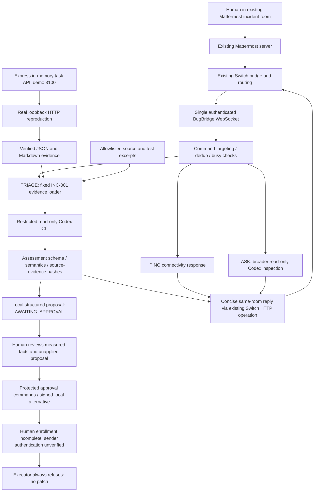

# BugBridge architecture

Scope: local incident investigation and human review.

## Runtime and ports

| Component | Address / responsibility |
| --- | --- |
| BugBridge demo REST API | Explicit HOST=127.0.0.1, PORT=3100; underlying unchanged default is 3000 |
| Existing Switch Gateway | Keep existing configuration; inspected standalone Compose default is 3000 |
| Existing Switch core | BugBridge client currently uses loopback port 8000; preserve existing endpoint |
| Mattermost | Existing configured deployment/bookmark; inspected standalone default is 8065, not proof of the running port |
| Test/smoke/reproduction servers | Independent loopback ephemeral ports; no dependency on demo port 3100 |

Bind checks during Phase 14 found 3000 occupied and 3100 available. The occupying process was not authenticated as the Gateway, and no service was stopped. Recheck 3100 before startup; releasing a probe socket is not a reservation. The actual API bind handles any race by refusing startup.

The API and bridge are separate Node processes with separate lockfiles. Starting the API does not connect to Switch or Codex. There is no new frontend, database, Docker stack, agent registration or room provisioner in BugBridge.

## Data contracts and trust boundaries

1. Mattermost text is untrusted input. The handler accepts explicit commands only in the configured room and filters duplicates/self replies. PING remains responsive during asynchronous analysis.
2. TRIAGE accepts only the fixed INC-001 registry entry. Evidence must include a valid 201 control, both expected-400/observed-500 cases, storage/health/cleanup success and matching JSON/Markdown. Paths, excerpts and line numbers come from inspected local files, never model/chat suggestions.
3. Codex receives checked scalar observations and exact source excerpts. TRIAGE disables tools/integrations/user config, uses a read-only sandbox, fixed arguments without a shell, stdin EOF and bounded runtime/output. ASK has a broader inspection surface; its prompt/redaction is not a complete confidentiality boundary.
4. A constrained assessment is validated before producing the structured proposal. JSON and Markdown are staged separately and source/evidence rechecked before persistence. A mismatch fails closed; a multi-file atomic transaction is not claimed.
5. Replies use the existing authenticated Switch client and same configured room. HTTP acceptance is not proof that Mattermost rendered the reply. Manual verification must observe rendering.
6. WeakMap transport provenance, canonical sender_kind=user, exact full allowlisted identity, room/message/agent binding and self exclusion are required for metadata approval. Deployed provenance/classification remains unverified, so activation is prohibited. Usernames, client_type=user and room membership do not authorize.
7. Signed-local approval requires a real operator-controlled Ed25519 key, verified enrollment, integrity-bound intents, one-use challenge, expiry and persistent replay protection. It cannot bypass absent enrollment. Even a valid synthetic APPROVED record cannot execute a patch: FIX_EXECUTION_ENABLED=false and the entry point refuses.

## Evidence provenance

Measured observations are real local HTTP responses. Root cause and minimal fix are source-supported analysis, not a collected stack trace or an executed repair. At the Phase 16A review, `reports/incidents/INC-001-triage.json` records `rootCause.analyst: CODEX_CLI`. Earlier local-review artifacts used LOCAL_SOURCE_REVIEW. The current provenance field is an inspected artifact value; this publication review did not observe its model invocation or a fresh Mattermost reply.

The operator previously observed real PING, ASK/Codex and TRIAGE successes in earlier sessions. No fresh latest-session TRIAGE response was verified here, so current live acceptance remains PENDING. A new live claim requires an observed same-room reply associated with that command and report. The historical Phase 14 normal suites recorded 300 passed, 0 failed, 1 skipped; the later communication investigation recorded 278 passed, 22 failed, 5 skipped and was blocked. Phase 16A ran only publication security tests: 11 passed, 0 failed, 0 skipped. See the [dated verification record](submission-checklist.md#phase-14-verification-results); none of these test totals establishes live delivery.

Automated protocol tests use an isolated mock Switch peer and mocked Codex subprocess, plus real Node HTTP/WebSocket/file/schema/crypto operations. They do not attest to the deployed image, human account control or bot classification. See [verification results](end-to-end-verification.md), [security review](security-review.md), [local runbook](demo-workflow.md) and [submission checklist](submission-checklist.md).
